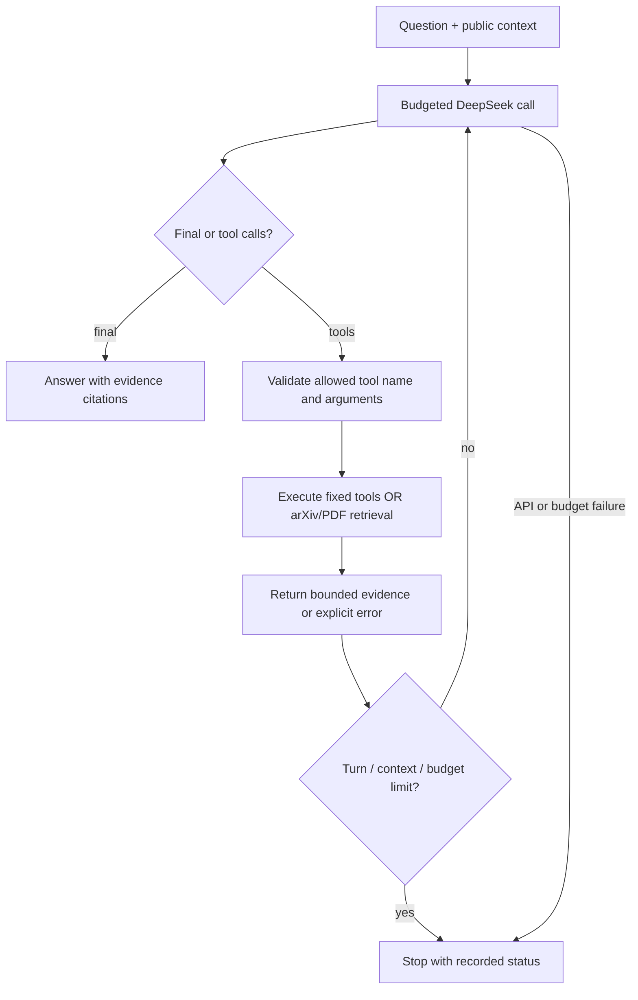
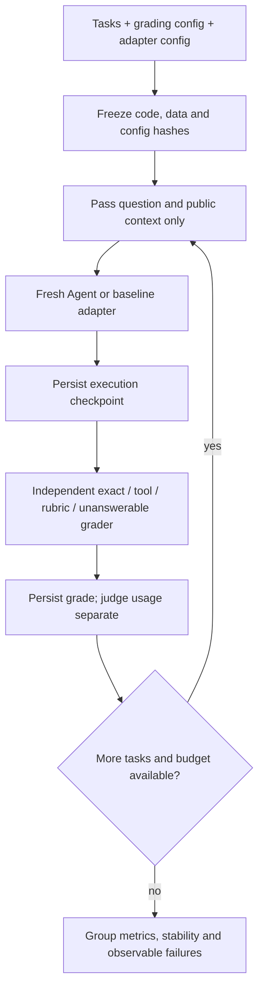

# Paper Agent Eval

A small, extensible agent-evaluation toolkit with a command-line arXiv research
agent as its reference application. Evaluate your own agent through a narrow
Python interface, or search papers, retrieve bounded PDF passages and ask
source-grounded questions. No frontend, embedding API or vector service.

The engineering contribution is the combination of task-blind adapters,
observable tool execution, explicit graders, reproducible checkpoints and one
persistent cost gate. This is not a new research algorithm or a claim of broad
benchmark superiority.

## What is implemented and verified

|Capability|Implementation|Verification|
|---|---|---|
|Domain-independent adapter and evaluation loop|contracts.py, evaluation.py|Non-paper reverse-string adapter, resume and mismatch tests|
|Actual model-selected tool loop and baseline|agent.py, papers.py|Offline loop fixtures, real full-text smoke and 12 formal task executions; historical traces separate|
|Fixed / online separation|papers.py, arxiv.py|Fixed tools reject online calls; cache-only evaluation rejects network|
|Versioned arXiv metadata and bounded downloads|arxiv.py|Atom parsing, ID/URL boundary, malformed response and cache-integrity tests; real arXiv search and two versioned PDF downloads passed|
|PDF pages and lexical retrieval|retrieval.py, pdfworker.py|Own-PDF extraction plus 25-page NeRF/DDPM indexing with pypdf; real page citations checked|
|Persistent cost reservations|budget.py, provider.py|Restart, stop threshold, missing usage and uncertain timeout/retry tests|
|Historical results recomputation|history.py|All 250 preserved records recomputed offline under both exact policies|

Full code-to-evidence mapping: [architecture](docs/architecture.md).

## Quick start

Python 3.9+. The core has no runtime dependencies. For portable PDF extraction,
install the optional pypdf dependency; macOS also has a PDFKit fallback.

```sh
git clone https://github.com/Williamdu29/paper-agent-eval.git
cd paper-agent-eval
python3 -m venv .venv
source .venv/bin/activate
python -m pip install --upgrade pip
python -m pip install -e '.[pdf]'
python -m unittest discover -s tests -v
pae history --output /tmp/paper-agent-history.json
```

The package and CLI are location-independent; no private source directory or
pre-existing credential file is needed.

For paid model calls, export your own key in your terminal (do not paste it into
a command saved in shell history). Alternatively edit a local ignored `.env`
from `.env.example`, then pass `--env-file .env` explicitly. Environment values
win over dotenv. No automatic ancestor-directory secret discovery occurs.
The original key is not bundled, copied or embedded. There is no hosted service.

```sh
pae --env-file .env ask 'What does DUSt3R regress? Return only the representation.' --mode fixed
pae --env-file .env ask 'Compare camera prerequisites of DUSt3R and NeRF. Cite evidence.' --mode fixed
```

Fixed mode contains exactly ten saved arXiv abstracts and metadata: NeRF, DDPM,
DDIM, Score SDE, Latent Diffusion, Understanding Diffusion, Flow Matching, DiT,
DUSt3R and MASt3R. It never accesses the network or substitutes full text.
Original authors, version URLs, retrieval dates and portable snapshot hashes
are in `src/paper_agent_eval/data/manifest.json`.

## Online arXiv and PDF research

```sh
pae search 'neural radiance fields' --limit 3
pae index 2003.08934v2
pae retrieve 2003.08934v2 'batch size coarse fine samples' --top-k 4
pae --env-file .env ask 'Read NeRF 2003.08934v2: what batch size and sampling counts are used? Cite PDF pages.' --mode online
```

Only arXiv is supported. Search returns descriptive metadata; `read_paper`
returns an abstract. `retrieve_text` downloads a public, versioned PDF,
extracts text by file page, chunks it and returns at most top-k lexical matches.
The model chooses tools; the program actually executes them and returns results.
It never inserts the whole PDF into each model request.

Requests use one connection and a shared minimum 3.1-second interval; 429 stops
rather than switching endpoints. Caches are local and ignored by Git. Defaults:
50 MB PDF maximum, 30-second download timeout, one retry, at most 200 PDF pages,
1200-character chunks with 150 overlap, top-k 4 (maximum 8), 6000 evidence
characters and a 60000-character overall model context guard. Programmatic
`Index`/`retrieve` parameters allow bounded customization. The Agent stops after
eight logical turns, a context cap, provider failure or budget exhaustion.

Citations use `[arXiv ID, PDF p. N]`: one-based **PDF file pages**, not printed
page labels. No OCR, diagram interpretation or table understanding is claimed.
Encrypted, corrupt, oversized and textless/scanned files fail explicitly.
Multicolumn order, formulas and tables may extract poorly. PDF parsing is a
bounded subprocess; source text is untrusted data and is never executed.
Only validated modern arXiv IDs and plain HTTPS arXiv links are accepted. Tools
cannot open arbitrary local paths, `.env`, answers or private files. PDF requests
never carry DeepSeek credentials. See [data and sources](docs/data.md).

## Agent pipeline



## Reuse the evaluator

A deterministic non-paper example demonstrates integration without changing any
core or paper module. Its outputs are fixtures, not model-performance results.

```sh
pae eval --tasks examples/reverse.tasks.jsonl --config examples/reverse.json --out runs/reverse
# Same command resumes from completed records and per-task checkpoints.
pae report --tasks examples/reverse.tasks.jsonl --records runs/reverse/records.jsonl
```

Implement `run(Input) -> Result` plus a `factory(config, client)` function.
`Input` contains only question and explicitly allowed public context; no expected
answer, task type or rubric. `Result` includes answer, status, observable messages
and tool calls, model-call count, latency and optional token usage. Use the
supplied budgeted client for every paid call. An arbitrary third-party adapter
can perform its own I/O; this interface is not a sandbox for untrusted Python.
See the minimal [adapter guide](docs/extending.md).



For a new fixed-paper experiment (not a rerun of historical results):

```sh
pae --env-file .env eval --tasks benchmarks/historical/tasks.jsonl --config examples/fixed.json --out runs/fixed-agent --system agent --paid
pae --env-file .env eval --tasks benchmarks/historical/tasks.jsonl --config examples/fixed.json --out runs/fixed-baseline --system baseline --paid
```

These share the global budget. Do not run them merely to reproduce the existing
historical table; `pae history` is free and sufficient. Custom task counts are
not fixed at 50. See [evaluation](docs/evaluation.md) for grading, stability and
versioning. `--paid` is explicit so offline examples cannot accidentally call a
judge or provider.

## Historical benchmark (fixed abstracts, original technical version)

These are recomputed from preserved real logs, not results of the reorganized
code. The old technical fingerprint and export/sanitization relationship are in
`benchmarks/historical/provenance.json`. Both exact rules are shown; no alias was
added after inspecting outcomes. Original rubric verdicts remain unchanged.

|Metric|Agent strict|Baseline strict|Agent contains|Baseline contains|
|---|---:|---:|---:|---:|
|**Non-tool accuracy (40 tasks)**|92.5%|60%|92.5%|60%|
|Overall accuracy (50 tasks)|94%|48%|94%|48%|
|Average model calls / task|1.86|1.00|1.86|1.00|
|Average latency (seconds)|3.9897|2.4290|3.9897|2.4290|
|P95 latency (seconds)|8.0481|6.4219|8.0481|6.4219|
|Average total tokens / task|3334.08|1136.50|3334.08|1136.50|
|Usage coverage|50/50|50/50|50/50|50/50|

Agent main type scores: exact 17/20, tool 10/10, rubric 15/15,
unanswerable 5/5. Baseline: 12/20, 0/10, 7/15, 5/5. Three additional independent
Agent runs each scored 47/50; pass@3 and pass^3 are both 94%, with no pass/fail
flips. The stable exact failures are t01, t03 and t16. t03 varies its wrong answer
without a scoring flip. Full generated groups and all types are available via
`pae history`.

The baseline had no tools and therefore structurally failed tool tasks. Both
systems received a metadata catalogue; only Agent could retrieve abstracts.
This is an evidence-access and tool-loop comparison, not proof that all gains
come from reasoning. The rubric judge has a known false positive on baseline
t44 despite contradictory NeRF evidence; the scores inherit that limitation.
See the [real failure analysis](docs/failure-analysis.md).

## Real full-text mini-evaluation: separate from history

Six frozen questions covering versioned NeRF and DDPM body text were run once
through Agent and baseline (12 formal executions). Two own-fixture download and
parse error tests are separate offline robustness cases, not model scores.
Formal runs use the frozen local PDF/index cache; live search/download was
validated separately. No historical model experiment was rerun.

|Metric|Agent|Baseline|
|---|---:|---:|
|LLM-judge pass /6|6/6|1/6|
|Overall / non-tool accuracy|100% / 100%|16.67% / 16.67%|
|Average model calls / task|2.6667|1.0000|
|Average latency (seconds)|7.8437|2.5970|
|P95 latency (seconds)|18.4243|4.5491|
|Average total tokens / task|5181.67|326.33|
|Usage coverage|6/6|6/6|

This small result is **not a broad quality guarantee**. Baseline receives no PDF
passages; its five body-question responses contain pseudo-tool markup or a
promise to search, with zero actual tools executed. Both systems pass the
missing-private-data refusal. A spot check found Agent fulltext-05 overstates
DDPM's constant-rate/absence-of-decay claim, and fulltext-06 adds a PSNR formula
without retrieved support; the judge still passes Grounded. These limitations
are disclosed rather than silently corrected or hidden behind 100%.

Real text/tool connectivity, full-text smoke and blind judge positive/negative
calibration passed before the formal run. All new paid requests, including those
checks and judge calls, total **41 requests, 61,046 reported tokens**, with
**$0.1284888 conservative exposure** (peak cache-miss prices ×1.25), not a provider
invoice. There were no retries or uncertain usage groups. The persistent ledger
was preserved and consolidated into the single default global location.

[Full results](benchmarks/online/results.md), per-task grades, versioned sources,
actual PDF/index hashes, parser versions and budget totals are in
`benchmarks/online/`. Public evidence traces contain page/offset/length/hash,
not full text. One response containing long verbatim PDF quotes is explicitly
withheld with its original hash; the unchanged original remains local. No PDF,
index or long extracted passage is distributed. No three-run stability claim
is made for this six-task mini-set.

To prepare and evaluate locally once networking works:

```sh
python scripts/prepare_online.py
pae --env-file .env eval --tasks benchmarks/online/tasks.jsonl --config .local-run/online-config.json --out runs/fulltext-v1-agent --paid
pae --env-file .env eval --tasks benchmarks/online/tasks.jsonl --config .local-run/online-config.json --out runs/fulltext-v1-baseline --system baseline --paid
```

Preparation downloads/indexes references and writes a local config listing every
PDF/index/manifest hash input. Formal evaluation is cache-only: no live data
changes mid-run. Do not publish `.cache`, complete extracted text or PDFs.

## Shared cost control

Every project-provided paid call (Agent, baseline, judge, retry) goes through
`DeepSeek.call` and the same durable SQLite ledger, by default
`~/.local/state/paper-agent-eval/budget.sqlite3`. Set `PAE_BUDGET_DB` once to move
it; never change/reset it to evade an experiment's shared cap. Ledger transactions
reserve the full prompt/output bound and all allowed retries before dispatch.
Timeouts, missing usage and process interruptions keep conservative exposure.
SDK implicit retries do not exist. Defaults stop new calls when exposure plus
reservation would exceed **$4.50**, under the **$5 ceiling**.

```sh
pae budget
```

Prices were checked on 2026-11-18 at the
[official DeepSeek model table](https://api-docs.deepseek.com/quick_start/pricing/).
Peak cache-miss Pro prices are $1.32/M input and $3.96/M output; Flash prices
$0.30/M input and $1.20/M output. A 1.25 safety factor is applied, no cache or
off-peak discount credited. Prices expire after seven days; an unverified model
or stale price record blocks paid requests. Input reservation uses four times
serialized UTF-8 bytes plus 8192 framing tokens, and the full output cap. This is
a conservative upper-bound policy, not an exact tokenizer count. Unexpected
provider accounting still requires reconciliation; ledger values are exposure
estimates, not the provider invoice. Model choice is configurable through
`DEEPSEEK_MODEL` only when a verified price exists. Thinking is explicitly off.

## Release boundaries

No bundled key, public paid endpoint, downloaded PDFs, full-text caches or private
paths. Candidate files, staged files and all accessible Git history can be
scanned with `python scripts/audit_release.py`; a known key may be read into
memory through `--known-env-file` without being printed or persisted.
CI runs offline tests and historical recomputation, requires no API secret and
downloads no papers. See [NOTICE](NOTICE): no source code license existed in the
input snapshot, so this repository does not assert a blanket license on behalf
of others. Paper authors and their independent content rights remain intact.
